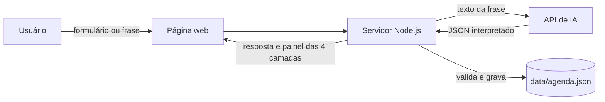
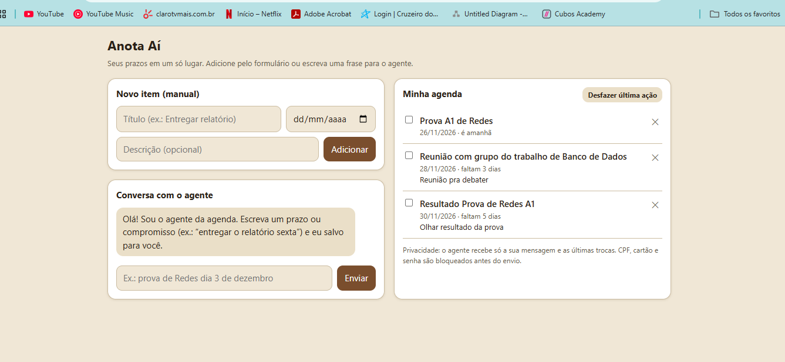
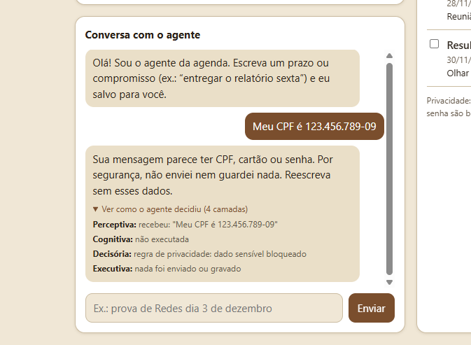

# Anota Aí

Os prazos da faculdade ficam espalhados no WhatsApp, no portal e nas anotações. O **Anota Aí** junta tudo em **uma agenda simples**: cada item tem **título, dia e descrição**.

**Demonstração online:** https://iguin-008.github.io/Tendencias_ia_Sistemas_Informacao/Unidade4/demo/

Há duas formas de adicionar um item:

1. **Formulário:** preencha título, dia e descrição (não usa IA).
2. **Agente de IA:** escreva uma frase, como "prova de Redes dia 3 de dezembro", e o agente preenche os campos e salva.

**Disciplina:** Tendências em Ciência da Computação — Unidade 4

## Integrantes

- **Igor Almeida dos Santos**
- **Thomas Kristyann Santos Dias**

## Como funciona

A IA **só interpreta** a frase. Quem valida e grava é o servidor, em quatro camadas:

| Camada | O que faz |
|---|---|
| Perceptiva | Recebe a mensagem, limita o tamanho e bloqueia CPF, cartão e senha |
| Cognitiva | A IA identifica a intenção e extrai título, dia e descrição |
| Decisória | O servidor confere título, data válida e data não passada, e limita a 3 itens |
| Executiva | O servidor salva na agenda e guarda uma cópia para desfazer |



Escolhas de projeto: todas as mensagens que o usuário lê são escritas pelo grupo (a IA não gera texto de resposta), a última ação pode ser desfeita, e o painel "Ver como o agente decidiu" mostra cada camada.

## Ferramentas utilizadas

| Ferramenta | Para que serve no projeto |
|---|---|
| Node.js 18+ | Servidor, regras de validação e agente (sem bibliotecas externas) |
| API de IA da Anthropic (modelo configurável em `MODEL`) | Interpretar a frase e extrair título, dia e descrição |
| HTML, CSS e JavaScript | Página com formulário, conversa e agenda |
| SERPROBOT (documentação) | **Referência de método**: etapas do fluxo de trabalho e conceitos de intenção, entidade e variável. O projeto não foi construído na plataforma |
| GitHub | Repositório e entrega da disciplina |

## Prints do sistema

### Agenda com prazos cadastrados pelo formulário



### Bloqueio de CPF fictício no chat



O agente identificou o padrão de CPF na mensagem e interrompeu o fluxo antes de chamar a IA.

## Como rodar

Requisito: Node.js 18 ou superior (não há nada para instalar).

```bash
cp .env.example .env      # no Windows: copy .env.example .env
# edite o .env e coloque sua ANTHROPIC_API_KEY
node server.js
```

Abra http://localhost:3000. Sem a chave, o formulário e a agenda funcionam, e só o agente fica desativado.

A chave fica apenas no servidor e o `.env` está no `.gitignore`: **nunca envie o `.env` ao GitHub**.

## Ética e limites

- A IA não tem poder de gravar, apagar ou concluir itens: só interpreta. Toda ação do agente pode ser desfeita.
- O sistema bloqueia CPF, cartão e senha antes de enviar qualquer coisa à IA. **Não bloqueia** e-mail, telefone com espaços nem nomes de pessoas.
- A interpretação pode errar (datas ambíguas, gírias, escrita informal). Confira sempre a confirmação.
- Foi testado apenas pelo grupo, com apoio de um assistente de IA no lugar da API paga, e sem usuários externos. Não há login e os dados ficam em um arquivo local sem criptografia.
- A análise completa de vieses, impactos e responsabilidade social está em `docs/Analise_Etica.md`.

## Arquivos

```
server.js           servidor: agente de 4 camadas e regras de validação
public/index.html   página: formulário, conversa com o agente e agenda
docs/               documentação do projeto
```

## Documentação

Na pasta `docs/`, seguindo o fluxo de trabalho do SERPROBOT:

- `Documento_de_Visao.md`: problema, visão geral, restrições, arquitetura, usuários e referências (etapa *Entender a Necessidade*).
- `Acervo.md`: fontes de apoio e conjunto de frases de exemplo (etapa *Coletar Acervo*).
- `Estrutura_do_Projeto.md`: organização do repositório, correspondência com as pastas sugeridas e situação das etapas (etapa *Montar Estrutura*).
- `Persona_e_Identidade_Visual.md`: persona, tom de voz, linha artística, cores e tipografia (etapa *Id. Visual e Persona*).
- `Modelagem_do_Chatbot.md`: estratégia, intenções, entidades, fluxos, diálogos de amostra e casos de teste (etapa *Modelar o Chatbot*).
- `UX_Writing.md`: revisão das mensagens do agente com os princípios de UX Writing (etapa *UX Writing*).
- `Analise_Etica.md`: vieses, avaliação crítica, frameworks éticos, responsabilidade social e testes de viés e adversariais (aula de 19/11).

## Nota sobre o uso de IA

Parte do código e da documentação deste projeto foi elaborada com apoio de um assistente de IA (Claude, da Anthropic) e revisada pelo grupo.
