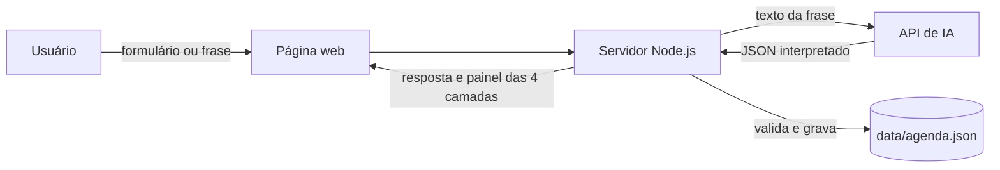

# Documento de Visão do Chatbot — Anota Aí

**Disciplina:** Tendências em Ciência da Computação — Unidade 4 (Projeto Final)
**Professora:** Kadidja Valéria
**Integrantes:** Igor Almeida dos Santos e Thomas Kristyann Santos Dias

## Introdução

Este documento contém as informações gerais do chatbot **Anota Aí**, uma agenda da faculdade com um agente de IA, visando garantir o entendimento do projeto. Ele segue a estrutura do modelo "Documento de Visão do Chatbot", da etapa **Entender a Necessidade** do fluxo de trabalho da documentação do SERPROBOT, adaptada a um projeto acadêmico.

É composto pelos itens a seguir: Problema, Visão Geral, Restrições, Arquitetura Básica, Usuários, Partes Interessadas, Futuro e Referências.

## 1. Problema

Os prazos e compromissos da faculdade chegam por canais diferentes: avisos no grupo de WhatsApp da turma, comunicados no portal da instituição e recados dados em sala de aula. Cada estudante acaba anotando em lugares distintos (conversas, cadernos, notas do celular), e não existe um único lugar para consultar o que vence primeiro.

### Por que o problema existe

- Cada canal tem um dono e um propósito diferentes, e nenhum deles foi feito para organizar os prazos de quem os recebe.
- Mensagens de WhatsApp se perdem no meio de outras conversas.
- Anotações em sala dependem de a pessoa lembrar de copiá-las para outro lugar.
- Preencher uma agenda tradicional (título, data, detalhes, em vários campos) dá trabalho, e esse atrito faz a pessoa desistir de anotar.

### Contexto

O ambiente é o de estudantes de graduação que lidam, ao mesmo tempo, com várias disciplinas, entregas, provas e trabalhos em grupo.

### Problema, necessidade, motivação e solução

| Item | Descrição |
|---|---|
| **Problema** (fato real) | Prazos espalhados em vários canais, sem um lugar único para consulta |
| **Necessidade** (o que precisa ser feito) | Reunir os prazos em uma lista só, ordenada pela data, com pouco esforço para registrar |
| **Motivação** | Evitar esquecer entregas e provas e reduzir o tempo gasto organizando anotações |
| **O que o Anota Aí resolve** | Oferecer uma agenda simples e um agente que transforma uma frase escrita pelo usuário em um item da agenda |

## 2. Visão Geral

O **Anota Aí** é uma agenda da faculdade em que cada item tem **título, dia e descrição**. O usuário pode adicionar itens de duas formas:

1. **Formulário:** preenche título, dia e descrição (não usa IA).
2. **Agente de IA:** escreve uma frase, como "prova de Redes dia 3 de dezembro", e o agente identifica título, dia e descrição e salva o item.

### Objetivo

Oferecer um lugar único onde o estudante consulta o que vence primeiro, reduzindo o esforço de registrar cada prazo.

### O que o Anota Aí vai resolver

- Registrar prazos e compromissos a partir de uma frase em linguagem natural.
- Reunir tudo em uma lista ordenada por data, indicando quantos dias faltam ou se o prazo está atrasado.
- Permitir marcar itens como feitos, removê-los e desfazer a última ação.
- Mostrar ao usuário como o agente decidiu, em quatro etapas (percepção, interpretação, decisão e execução).

### O que o Anota Aí não vai resolver

- Não lê o WhatsApp, o portal da instituição nem qualquer outro sistema: o usuário escreve ou cola a informação.
- Não envia lembretes ou notificações.
- Não tem login nem listas separadas por pessoa.
- Não sincroniza com agenda de celular, e-mail ou calendário.
- Não prioriza nem sugere o que fazer primeiro.
- Não conclui nem remove itens por conversa: isso é feito pelos botões da lista.

### Principais recursos

- Formulário manual (título, dia, descrição opcional).
- Agente que cria até 3 itens por mensagem.
- Conversão de datas relativas (por exemplo, "sexta" ou "amanhã") em datas completas.
- Painel "Ver como o agente decidiu" com as 4 camadas.
- Botão para desfazer a última ação.
- Bloqueio de CPF, número de cartão e senha antes de qualquer envio à IA.

### Escopo do MVP

O escopo do MVP é composto por 3 grandes grupos:

- **Agenda:** criar (manual), listar por data, marcar como feito e remover.
- **Agente de IA:** interpretar uma frase e criar itens, com validação das regras antes de salvar.
- **Segurança e transparência:** bloqueio de dados sensíveis, painel das 4 camadas e desfazer.

## 3. Restrições

- O agente depende de uma **chave de API** de um provedor de IA e de conexão com a internet. Sem a chave, o formulário e a agenda funcionam, mas o agente fica desativado.
- A interpretação é feita por um modelo de linguagem e **pode errar** (datas ambíguas, gírias, frases incompletas). Por isso o servidor valida os dados antes de salvar.
- A **data é obrigatória**: itens sem data ou com data que já passou não são salvos.
- Limites: título de até 100 caracteres, descrição de até 200, mensagem de até 500 e até 3 itens por mensagem.
- A memória do agente é curta: considera apenas as últimas trocas da conversa.
- O desfazer guarda apenas **uma** ação anterior.
- Os dados ficam em um arquivo local (`data/agenda.json`), sem criptografia em repouso e sem login.
- O projeto roda localmente com Node.js. Não está publicado como serviço na internet.
- O Anota Aí **não foi construído na plataforma SERPROBot**: a documentação dela foi usada como referência de método (etapas do fluxo de trabalho e conceitos de intenções, entidades, variáveis e ações).
- Prazo de desenvolvimento limitado ao calendário da Unidade 4.

## 4. Arquitetura Básica

O sistema tem três partes: a **página web** (interface), o **servidor Node.js** (regras, guarda da chave e dados) e a **API de IA** (que apenas interpreta o texto). A IA nunca altera a agenda diretamente: quem valida e grava é o servidor.

### As 4 camadas do agente

| Camada | O que faz no Anota Aí |
|---|---|
| Perceptiva | Recebe a mensagem, limita o tamanho e bloqueia dados sensíveis |
| Cognitiva | A IA identifica a intenção e extrai título, dia e descrição |
| Decisória | O servidor confere título, data válida e data não passada, e limita a 3 itens |
| Executiva | O servidor salva na agenda e guarda uma cópia para desfazer |

### Arquivos principais

- `server.js`: servidor, regras de validação e agente.
- `public/index.html`: página com formulário, conversa e agenda.

## 5. Usuários

O público-alvo desta versão são os **dois integrantes do grupo**, que usam o sistema para organizar os próprios prazos da faculdade. O projeto foi pensado para estudantes de graduação em geral, mas não foi testado com outros usuários.

Os usuários dialogam com o agente em português, por texto, e sabem escrever frases curtas sobre prazos (por exemplo, "entregar o relatório sexta").

## 6. Partes Interessadas

| Pessoa | Atuação no projeto |
|---|---|
| Igor Almeida dos Santos | Desenvolvedor e usuário |
| Thomas Kristyann Santos Dias | Desenvolvedor e usuário |
| Profa. Kadidja Valéria | Avaliadora do projeto |

## 7. Futuro

- Login e agenda separada por usuário, com controle de acesso.
- Lembretes antes dos prazos.
- Entrada por colagem de mensagens do WhatsApp ou do portal, com cuidado especial com dados pessoais de terceiros (nomes e telefones).
- Criptografia dos dados em repouso e política de retenção, em conformidade com a LGPD.
- Testes com outros estudantes para avaliar a qualidade da interpretação e possíveis vieses (gírias e expressões regionais).
- Publicação em um serviço de hospedagem que execute Node.js.

## 8. Referências

- SERPROBOT. *Fluxo de Trabalho* e *Entender a Necessidade*. https://serprobots.estaleiro.serpro.gov.br/docs/dev/
- SERPROBOT. *Documento de Visão do Chatbot* (modelo). https://serprobots.estaleiro.serpro.gov.br/docs/dev/downloads/DVChatbot.pdf
- Material da disciplina: *Guia de Estudos A1 — Criação de Agentes de IA e Ética Aplicada* (Profa. Kadidja Valéria), Engenharia de Prompt e Aplicações em IA.
- BRASIL. Lei nº 13.709, de 14 de agosto de 2018 (Lei Geral de Proteção de Dados Pessoais — LGPD).

## Nota sobre o uso de IA

Parte do código e da documentação deste projeto foi elaborada com apoio de um assistente de IA (Claude, da Anthropic) e revisada pelo grupo.
